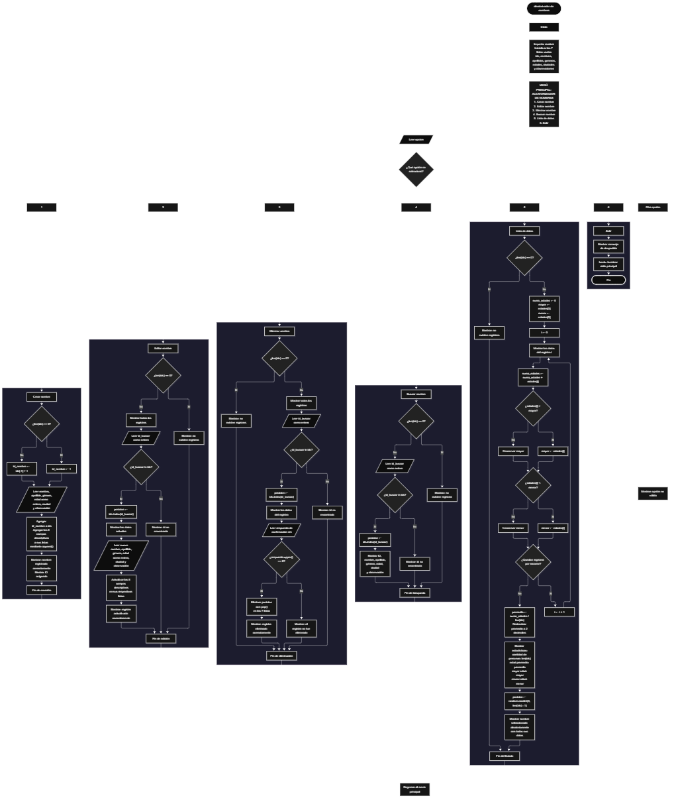

 

Este proyecto, llamado <b>aleatorizador de nombres</b>, fue desarrollado en <b>python</b> como un ejercicio práctico para fortalecer la lógica de programación mediante la creación de un sistema de gestión de personas desde la consola. El programa cuenta con un menú principal de seis opciones que permite <b>crear, editar, eliminar, buscar y listar registros, además de seleccionar una persona aleatoriamente</b>. Cada persona almacena datos como el nombre, el apellido, el género, la edad, la ciudad y las observaciones. Para organizar la información se utilizan siete listas paralelas que mantienen relacionados los datos de cada registro durante la ejecución. Durante su desarrollo se aplicaron conceptos fundamentales de programación, como variables, listas, estructuras condicionales, ciclos repetitivos, búsqueda por identificador, operaciones de modificación y eliminación, cálculos estadísticos y selección aleatoria mediante el módulo <b>random</b>. Este proyecto permite poner en práctica los conocimientos adquiridos en Python y sirve como base para desarrollar sistemas de gestión más avanzados utilizando otros lenguajes y tecnologías.

<h2 align="center">⚙️ Funcionamiento del menú principal</h2>

### ➕ Crear nombre

La opción <b>1) crear nombre</b> permite registrar una nueva persona en el sistema. Antes de realizar el registro, el programa comprueba si la lista <b>ids</b> está vacía mediante la condición <b>len(ids) == 0</b>. Si no existen registros, asigna el identificador inicial <b>1</b> a la variable <b>id_nombre</b>. Si ya existen personas registradas, calcula el siguiente identificador sumando uno al último ID almacenado mediante la expresión <b>ids[-1] + 1</b>. Después, solicita el <b>nombre, apellido, género, edad, ciudad y observación</b> de la persona. La edad se convierte a un número entero mediante <b>int()</b>. Finalmente, almacena el identificador y los seis campos descriptivos en sus respectivas listas utilizando <b>append()</b>, muestra el mensaje <b>"nombre registrado correctamente."</b> e imprime el ID asignado. Los registros se conservan en memoria mientras el programa permanece en ejecución.

### ✏️ Editar nombre

La opción <b>2) editar nombre</b> permite modificar los datos de una persona registrada. Primero, el programa comprueba si existen registros mediante <b>len(ids) == 0</b>. Si no hay personas almacenadas, muestra el mensaje <b>"no existen registros."</b>. En caso contrario, presenta una lista con el ID, nombre, apellido, género, edad, ciudad y observación de cada persona. Después, solicita el identificador del registro que se desea editar y lo convierte a entero mediante <b>int()</b>. Para comprobar si la persona existe, utiliza la condición <b>id_buscar in ids</b>. Si el ID se encuentra en la lista, obtiene su posición con <b>ids.index(id_buscar)</b>, muestra los datos actuales y solicita los nuevos valores de los seis campos descriptivos. Los cambios se realizan directamente en las posiciones correspondientes de las listas, mientras que el ID original se mantiene sin modificaciones. Finalmente, muestra el mensaje <b>"registro actualizado correctamente."</b>. Si el identificador no existe, presenta el mensaje <b>"id no encontrada."</b>.

### 🗑️ Eliminar nombre

La opción <b>3) eliminar nombre</b> permite eliminar una persona registrada mediante su identificador. Antes de comenzar, el programa comprueba si existen registros. Si las listas están vacías, muestra el mensaje <b>"no existen registros."</b>. Si hay personas almacenadas, presenta una lista con todos sus datos y solicita el ID del registro que se desea eliminar. Después, comprueba si el identificador existe mediante <b>id_buscar in ids</b> y obtiene su posición utilizando <b>ids.index(id_buscar)</b>. A continuación, muestra los datos de la persona y solicita confirmación mediante la pregunta <b>"¿desea eliminar este registro? (s/n):"</b>. Si la respuesta convertida a mayúscula mediante <b>respuesta.upper()</b> es igual a <b>"S"</b>, elimina la posición correspondiente de las siete listas utilizando <b>pop(posicion)</b>. De esta manera, mantiene relacionados los datos de cada persona después de la eliminación. Finalmente, muestra el mensaje <b>"registro eliminado correctamente."</b>. Si el usuario no confirma la operación, presenta el mensaje <b>"el registro no fue eliminado."</b>. Si el ID no existe, muestra <b>"id no encontrada."</b>.

### 🔎 Buscar nombre

La opción <b>4) buscar nombre</b> permite localizar una persona mediante su ID. Primero, el programa comprueba si existen registros. Si no hay personas almacenadas, muestra el mensaje <b>"no existen registros."</b>. En caso contrario, solicita el identificador que se desea consultar y lo convierte a entero mediante <b>int()</b>. Después, utiliza la condición <b>id_buscar in ids</b> para comprobar si el identificador está registrado. Cuando encuentra una coincidencia, obtiene la posición correspondiente mediante <b>ids.index(id_buscar)</b> y muestra el ID, nombre, apellido, género, edad, ciudad y observación de la persona. Si el identificador introducido no se encuentra en la lista, presenta el mensaje <b>"id no encontrada."</b>. Esta función permite consultar un registro específico sin necesidad de mostrar todos los datos almacenados.

### 📋 Lista de datos

La opción <b>5) lista de datos</b> permite visualizar todos los registros y obtener estadísticas relacionadas con las edades de las personas. Primero, el programa comprueba si existen registros. Si las listas están vacías, muestra el mensaje <b>"no existen registros."</b>. En caso contrario, inicializa las variables <b>suma_edades</b>, <b>mayor</b> y <b>menor</b>. La suma comienza en <b>0</b>, mientras que la mayor y la menor edad se inicializan con el primer valor de la lista <b>edades[0]</b>. Después, utiliza un ciclo <b>for</b> para recorrer los registros, mostrar todos los datos de cada persona y acumular sus edades en la variable <b>suma_edades</b>. Durante el recorrido, compara cada edad con los valores de <b>mayor</b> y <b>menor</b> para actualizar la edad máxima y la mínima. Al finalizar, calcula el promedio mediante <b>suma_edades / len(ids)</b> y lo redondea a dos decimales con <b>round(promedio, 2)</b>. A continuación, muestra la cantidad de personas, la edad promedio, la mayor edad y la menor edad. Finalmente, utiliza <b>random.randint(0, len(ids) - 1)</b> para seleccionar una posición aleatoria válida y presenta todos los datos de la persona seleccionada. Esta opción combina la consulta general de los registros con el análisis estadístico y la selección aleatoria de una persona existente.

### 🚪 Salir del menú principal

La opción <b>6) salir</b> permite finalizar la ejecución del programa. Cuando el usuario selecciona esta opción, el programa muestra el mensaje <b>"gracias por utilizar el aleatorizador de nombres."</b> y ejecuta la instrucción <b>break</b>, que termina el ciclo principal <b>while True</b>. De esta manera, el usuario puede utilizar las diferentes funciones de gestión de personas y finalizar el programa cuando lo desee.

<h2 align="center">🧠 Temas aplicados en el proyecto</h2>

### 📦 Variables

En este proyecto se utilizan variables para controlar las opciones del menú, asignar identificadores, almacenar temporalmente los datos introducidos, localizar registros, realizar cálculos estadísticos y seleccionar personas de manera aleatoria. Cada variable cumple una función específica dentro de las operaciones del sistema.

🔢 **Opcion:** Almacena la opción seleccionada por el usuario en el menú principal.

🆔 **Id_nombre:** Almacena el identificador asignado al crear una persona.

🔎 **Id_buscar:** Almacena el identificador introducido por el usuario para localizar un registro.

📍 **Posicion:** Almacena el índice correspondiente a la persona localizada en las listas.

📝 **Nombre, apellido, genero, edad, ciudad y observacion:** Almacenan temporalmente los datos introducidos al crear un registro.

🔄 **I:** Funciona como contador en el ciclo utilizado para recorrer y mostrar los registros.

📊 **Suma_edades:** Acumula las edades de todas las personas registradas.

⬆️ **Mayor:** Almacena la edad más alta encontrada durante el recorrido de los registros.

⬇️ **Menor:** Almacena la edad más baja encontrada durante el recorrido de los registros.

📈 **Promedio:** Almacena el resultado de dividir la suma de las edades entre la cantidad de personas registradas.

🎲 **Respuesta:** Almacena la respuesta del usuario para confirmar o cancelar la eliminación de un registro.

🎯 **Posicion:** También se utiliza para almacenar el índice seleccionado aleatoriamente mediante el módulo <b>random</b>.

### 🗃️ Listas

En este proyecto se utilizan siete listas paralelas para almacenar y organizar los datos de cada persona. Todas las listas mantienen la misma correspondencia de posiciones: el ID, nombre, apellido, género, edad, ciudad y observación ubicados en un mismo índice pertenecen al mismo registro. Por ejemplo, la información de una persona situada en la posición <b>0</b> se distribuye entre <b>ids[0], nombres[0], apellidos[0], generos[0], edades[0], ciudades[0]</b> y <b>observaciones[0]</b>. Esta organización permite registrar, consultar, modificar y eliminar personas manteniendo relacionados sus datos.

🆔 **Ids:** Almacena los identificadores de las personas registradas.

📝 **Nombres:** Almacena los nombres de las personas.

📄 **Apellidos:** Almacena los apellidos de las personas.

👤 **Generos:** Almacena los géneros registrados.

🔢 **Edades:** Almacena las edades de las personas como números enteros.

🏙️ **Ciudades:** Almacena las ciudades correspondientes a cada persona.

📋 **Observaciones:** Almacena las observaciones adicionales de cada registro.

### 🔀 Estructuras condicionales

En este proyecto se utilizan las estructuras condicionales <b>if, elif y else</b> para controlar las opciones del menú y determinar qué operación debe ejecutarse. También permiten comprobar si existen registros antes de realizar una operación, verificar si un ID está almacenado, decidir si se debe eliminar una persona según la respuesta de confirmación y actualizar los valores de las edades mayor y menor durante el recorrido. Estas condiciones permiten que el programa responda de acuerdo con los datos disponibles y las decisiones del usuario.

### 🔄 Estructuras repetitivas

El programa utiliza el ciclo <b>while True</b> para mantener activo el menú principal hasta que el usuario seleccione la opción de salida. Además, emplea ciclos <b>for</b> con <b>range(len(ids))</b> para recorrer las listas, mostrar los registros y calcular las estadísticas de las edades. Estos ciclos permiten procesar todos los datos almacenados sin tener que escribir instrucciones individuales para cada persona registrada.

### 🎯 Selección de opciones

El menú principal utiliza una estructura condicional formada por <b>if, elif y else</b> para identificar la opción introducida por el usuario. Cada alternativa ejecuta una operación específica: <b>crear, editar, eliminar, buscar, listar los datos o salir</b>. Cuando la opción no coincide con ninguno de los valores definidos, el bloque <b>else</b> muestra el mensaje <b>"opción no válida."</b>. Esta estructura organiza el funcionamiento del programa y facilita el acceso a las distintas operaciones disponibles.

### 🔍 Búsqueda mediante identificadores

El programa utiliza la lista <b>ids</b> para identificar cada registro mediante un número entero. La condición <b>id_buscar in ids</b> comprueba si el identificador existe y el método <b>ids.index(id_buscar)</b> permite obtener su posición dentro de la lista. Esa posición se utiliza posteriormente para consultar, editar o eliminar los datos correspondientes en las demás listas. De esta forma, las operaciones se realizan sobre el registro seleccionado sin depender del nombre o apellido de la persona.

### 🔢 Conversión de datos

La función <b>input()</b> recibe la información introducida por el usuario como texto. Para almacenar las edades como números enteros, el programa utiliza <b>int(input())</b> tanto durante la creación como durante la edición de un registro. Esta conversión permite realizar operaciones matemáticas con las edades, como sumarlas, calcular su promedio y determinar la mayor y la menor edad. Sin embargo, el programa no incorpora un control para gestionar entradas que no puedan convertirse a enteros.

### 📊 Cálculos estadísticos

El programa realiza varios cálculos para analizar las edades de las personas registradas. La variable <b>suma_edades</b> acumula los valores de la lista <b>edades</b>. Las variables <b>mayor</b> y <b>menor</b> permiten determinar las edades máxima y mínima mediante comparaciones sucesivas. La variable <b>promedio</b> almacena la suma de las edades dividida entre la cantidad de registros, y la función <b>round()</b> limita el resultado mostrado a dos decimales. Estas operaciones se realizan únicamente cuando existe al menos un registro, evitando calcular el promedio con una lista vacía o acceder a una primera edad inexistente.

### 🎲 Selección aleatoria

El módulo <b>random</b> se importa al comienzo del programa para permitir la selección aleatoria de una persona. En la opción <b>5) lista de datos</b>, la instrucción <b>random.randint(0, len(ids) - 1)</b> genera un índice entero comprendido entre la primera posición y la última posición ocupada de las listas. El índice seleccionado se almacena en la variable <b>posicion</b> y permite mostrar todos los datos de la persona correspondiente. La selección se realiza entre los registros existentes y no modifica ni agrega información a las listas.

<h2 align="center">¿Cómo se implementaron las operaciones crud en el proyecto?</h2>

Las operaciones <b>crud</b> se implementaron mediante las opciones del menú principal para administrar los registros de personas. La operación <b>crear</b> corresponde a <b>crear nombre</b>, donde se solicita la información de una nueva persona y se almacena en las listas mediante <b>append()</b>. La operación <b>leer</b> se realiza mediante <b>buscar nombre</b> y <b>lista de datos</b>, que permiten consultar un registro específico o visualizar todos los registros junto con sus estadísticas. La operación <b>actualizar</b> corresponde a <b>editar nombre</b>, donde se modifican los datos descriptivos de una persona identificada por su ID. Por último, la operación <b>eliminar</b> se realiza mediante <b>eliminar nombre</b>, donde se solicita confirmación y se eliminan los datos de la posición correspondiente mediante <b>pop()</b>. Estas operaciones utilizan listas, variables, condicionales y ciclos para gestionar la información almacenada temporalmente durante la ejecución del programa.

<h2 align="center">Diagrama de flujo del proyecto</h2>

<h2 align="center">🛡️ Validaciones del programa</h2>

### 📭 No existen registros

Esta comprobación se utiliza en las opciones de <b>editar, eliminar, buscar y lista de datos</b>. El programa verifica si la lista <b>ids</b> está vacía mediante la condición <b>len(ids) == 0</b>. Si no existen personas registradas, muestra el mensaje <b>"no existen registros."</b> y evita continuar con las operaciones que requieren información almacenada. Esta comprobación también impide que la opción de estadísticas acceda a <b>edades[0]</b> cuando no hay edades registradas.

### 🔎 Identificador no encontrado

Esta comprobación se utiliza durante las operaciones de <b>editar, eliminar y buscar nombre</b>. El programa verifica si el identificador introducido está presente en la lista <b>ids</b> mediante la condición <b>id_buscar in ids</b>. Si el ID existe, obtiene su posición y continúa con la operación correspondiente. Si no se encuentra, muestra el mensaje <b>"id no encontrada."</b>. Esta comprobación permite evitar que las operaciones se ejecuten sobre identificadores que no están registrados.

### 🗑️ Confirmación de eliminación

Antes de eliminar un registro, el programa solicita al usuario que confirme la operación mediante una respuesta de tipo <b>s/n</b>. La condición <b>respuesta.upper() == "S"</b> permite aceptar la letra <b>s</b> tanto en mayúscula como en minúscula. Si la condición se cumple, el programa elimina los datos de las siete listas en la posición correspondiente. Si no se cumple, conserva el registro y muestra el mensaje <b>"el registro no fue eliminado."</b>.

### 🔢 Conversión de edades e identificadores

El programa utiliza <b>int()</b> para convertir las edades introducidas al crear o editar una persona, así como los identificadores solicitados durante las operaciones de edición, eliminación y búsqueda. Esta conversión permite trabajar con números enteros, pero no existe una validación adicional para controlar entradas vacías o textos que no representen números enteros. Si el usuario introduce un valor no convertible, Python puede generar un error y detener la ejecución del programa.

### ⚠️ Opción no válida

El bloque <b>else</b> del menú principal muestra el mensaje <b>"opción no válida."</b> cuando el usuario introduce una opción diferente de los valores <b>1, 2, 3, 4, 5 y 6</b>. Esta comprobación permite informar al usuario de que la selección no corresponde a ninguna de las operaciones disponibles.

### 🆔 Asignación de identificadores

Al crear una persona, el programa asigna el ID <b>1</b> cuando no existen registros. Si ya hay registros, calcula el identificador mediante <b>ids[-1] + 1</b>. Este procedimiento permite asignar identificadores consecutivos mientras se agregan registros al final de la lista. Sin embargo, como el cálculo depende del último ID almacenado y no de un contador independiente, si se elimina el registro con el ID más alto, ese identificador puede volver a utilizarse en la siguiente creación.

### 💾 Almacenamiento temporal

Los datos se almacenan en listas creadas en la memoria del programa. El código no utiliza archivos, bases de datos ni mecanismos de persistencia para guardar los registros. Por esta razón, la información permanece disponible mientras la ejecución continúa, pero se pierde al finalizar el programa. Tampoco se establece una capacidad máxima explícita para la cantidad de personas que pueden registrarse.

<h2 align="center">🎯 Objetivo del proyecto</h2>

El objetivo principal de este proyecto es fortalecer la <b>lógica de programación</b> mediante el desarrollo de un sistema de gestión y selección aleatoria de personas en <b>python</b>. A través de su construcción se busca aplicar los conocimientos adquiridos sobre variables, listas, estructuras condicionales, ciclos repetitivos, búsqueda por identificadores, operaciones de modificación y eliminación, cálculos estadísticos y generación de valores aleatorios. Además, el proyecto permite comprender cómo organizar registros relacionados, consultar información específica, calcular estadísticas a partir de datos almacenados y seleccionar una persona aleatoriamente dentro de una aplicación de consola. De esta manera, establece una base para desarrollar sistemas de gestión más completos utilizando otros lenguajes y tecnologías.

